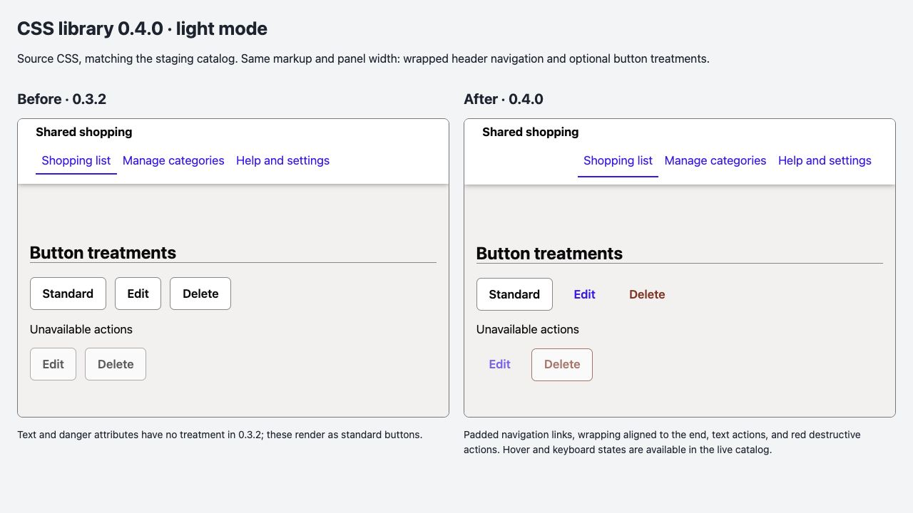
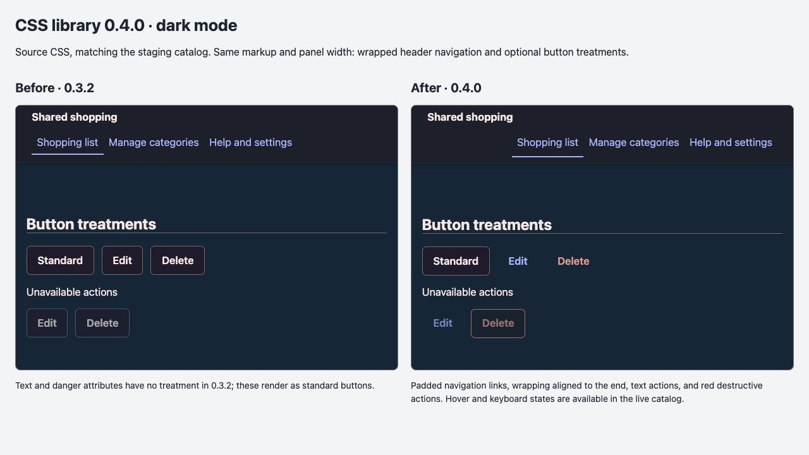

# CSS library 0.4.0 review evidence

The comparisons below use identical fixture markup and panel widths, with source CSS from `d63118de2481240b71572f071dd2a61f69178842` (0.3.2) and the accepted 0.4.0 implementation. Source files were bundled with Lightning CSS targeting Chrome 130 to preserve native `light-dark()` for the forced-theme comparison, as in the source-based catalog. Captured at 1280 × 720 in the local review browser. These are visual evidence, not a supported-browser certification.

The baseline does not implement the optional text/danger attributes, so those controls render as standard buttons. The main catalog and Headers page provide the complete interactive review, including hover, focus, disabled states, dialogs, inline forms, chips, disclosures and hidden-text examples.

## Verification

- Exact repository toolchain: Node 24.22.1 and pnpm 12.14.0.
- Frozen-lockfile install; lint, CSS build, optimized specimen build, release-helper tests, browser matrix, and package contents check.
- Browser matrix covers Chromium, Firefox and WebKit, desktop/narrow, light/dark; source and packaged CSS fixtures are included. Individual results are recorded in the PR and its CI reports.
- Independent GPT-6 Sol review covered library CSS, catalog HTML/JS, public guidance, compatibility, and test coverage; no release-blocking issue found.
- Actual screen-reader speech, real browser zoom, branded Safari and mobile devices were not independently verified for this final pass. Root-font enlargement tests do not substitute for browser zoom.
- The package's pre-existing system-preference theme selection differs from the catalog's forced-theme panels; see the package README for forced-theme adoption guidance.

No JavaScript, screenshots, workshops or private planning records are included in the npm package. The package dry run permits only `dist/barbajoe.css`, `README.md`, and `package.json`.
