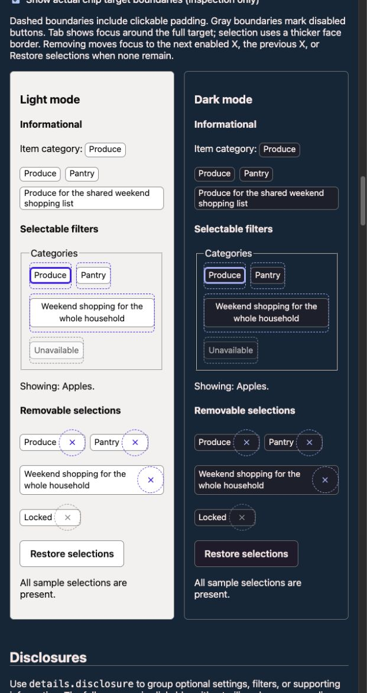
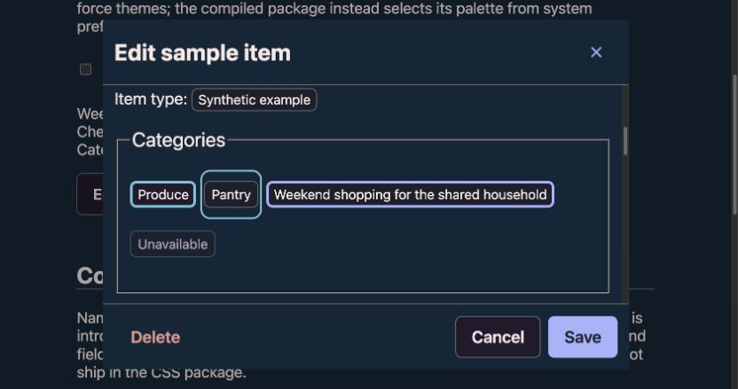

# CSS library 0.4.0 review evidence

The comparisons below use identical fixture markup and panel widths, with source CSS from `d63118de2481240b71572f071dd2a61f69178842` (0.3.2) and the accepted 0.4.0 implementation. Source files were bundled with Lightning CSS targeting Chrome 130 to preserve native `light-dark()` for the forced-theme comparison, as in the source-based catalog. Captured at 1280 × 720 in the local review browser. These are visual evidence, not a supported-browser certification.

The baseline does not implement the optional text/danger attributes, so those controls render as standard buttons. The main catalog and Headers page provide the complete interactive review, including hover, focus, disabled states, dialogs, inline forms, chips, disclosures and hidden-text examples.

## Verification

- Exact repository toolchain: Node 24.22.1 and pnpm 12.14.0.
- Frozen-lockfile install; lint, CSS build, optimized specimen build, release-helper tests, browser matrix, and package contents check.
- Browser matrix covers Chromium, Firefox and WebKit, desktop/narrow, light/dark; source and packaged CSS fixtures are included. Individual results are recorded in the PR and its CI reports.
- Independent GPT-6 Sol review covered library CSS, catalog HTML/JS, public guidance, compatibility, and test coverage; no release-blocking issue found.
- The earlier release pass did not verify actual speech, real zoom, branded Safari, or devices. The follow-up below adds actual Chrome 200% zoom evidence; speech, Safari, and devices remain outstanding. Root-font enlargement tests do not substitute for browser zoom.
- The package's pre-existing system-preference theme selection differs from the catalog's forced-theme panels; see the package README for forced-theme adoption guidance.

No JavaScript, screenshots, workshops or private planning records are included in the npm package. The package dry run permits only `dist/barbajoe.css`, `README.md`, and `package.json`.

## Chip target review

Joe selected the larger-target treatment for selectable and removable chips on October 25, 2026. Short interactive faces remain compact (28px at a 16px root), while buttons reserve targets at least 44×44px. Informational chips retain their compact noninteractive presentation. Removable chips reserve a separate X slot, so labels and adjacent chips are not part of that action's target.

This local catalog capture shows the optional target-boundary inspector. Dashed outlines follow the real button edges; solid keyboard-focus outlines take precedence. The catalog includes long labels, disabled states, working filters, removal and restore, and guidance on target spacing. The temporary A/B workshop remains local and is excluded from the package and maintained catalog.

## Remaining-review follow-up — October 25, 2026

The approved chip face/target design (`fe1bda4a`), disabled X color (`3be91ddb`), and informational vertical alignment (`a48d97c3`) are preserved. No further appearance or public field-label API was introduced.

- **CI diagnosis:** run 40204951707 finished 628 passed / 8 failed, all Firefox source/package chip-width assertions at line 47. Protocol bounding boxes reported 43.999969482421875 or 43.99999237060547 for CSS targets with a 44px minimum. A 0.001 CSS-pixel tolerance accommodates that measurement error; even 43.99px still fails. No target CSS changed. Padded clicks, adjacent overlap, focus, and disabled behavior remain tested.
- **Hidden reproduction:** before the fix, source and package fixtures exposed hidden header links/actions, informational/selectable/removable chips, chip lists, and inline row/action groups. The first keyboard stop after the sentinel entered hidden navigation. A shared ordinary-hidden rule now wins over component layout, replacing two isolated clear/icon fixes. Invalid values still hide; the case-insensitive until-found value retains native fragment reveal where supported. Checks cover hidden tab exclusion, reveal/activation/editing, and existing clear behavior.
- **Maintained editor:** source and package coverage includes draft Save/Cancel/Escape/Close, disabled/read-only state, selection, removal focus, long body scrolling, 320px reflow, Delete fallback focus and Restore. The independently reviewed locked-category state mismatch was reproduced in both builds and corrected; saved state now retains the disabled selection.
- **Documentation:** catalog contents/API guide, adjacent accessibility references, prominent theme caveat, generated-package theme page, and separate Our List adoption plan. Detailed naming, status timing, focus, and verification guidance remains in place.
- **Independent review:** fresh GPT-6 Sol reviewed the delta and surrounding implementation; its two findings (sample state and a documentation typo) were fixed and verified by the reviewer. No remaining actionable findings.
- **Package contents:** dry-run inspection permits only README.md, package.json, and dist/barbajoe.css. Editor scripts, layout CSS, evidence, and adoption plan are repository-only.

### Actual browser zoom evidence

Installed Google Chrome **155.0.8059.85**, macOS **27.0.1**, local source editor at `http://127.0.0.1:1244/editor.html`, system dark preference, October 25. Native Chrome zoom reset to 100%, then increased to **200%**, confirmed by the browser's accessibility/UI “Zoom: 200%” indicator (not CSS zoom or an enlarged root font). At 200%, the content viewport was 839×443 CSS px, root font 17.4143px, and page horizontal overflow was 0. The dialog measured about 598×399 CSS px; its body scrolled (249px client height / 1779px content height). Native Tab moved through Name, Notes, filters, removable chips, and footer actions; disabled controls were skipped. Cancel closed the dialog and restored Edit sample focus. Browser zoom was reset to 100% afterward.

This checks one installed browser/system theme and the editor composition, not all browser/screen-reader/device combinations. Automated desktop/narrow light/dark runs complement it but do not replace those checks.

### Outstanding listening and device checks — short test script

Actual screen-reader speech was **not listened to or recorded** in this run; accessibility-tree and DOM assertions are not speech evidence. Joe can complete this using VoiceOver with Safari or Chrome, recording browser/OS/VoiceOver versions and any repeated or missing speech:

1. In the preview catalog's **Visually hidden → Announce filter results**, start with All categories. Select Produce, then Pantry, then All categories. Expect the native control's option/state feedback plus one concise result update, with focus staying on the select. Note any duplicated application message; distinguish native menu instructions from the result region. Repeat quickly.
2. In **Give a repeated action context**, navigate to both Edit buttons: expect distinct names such as “Edit Apples” and “Edit Oats”, with no extra hidden-text tab stop. Activate one and listen to its local feedback.
3. In **Name an icon-only action**, reach Clear item name. Activate it: focus returns to the empty named input and the X leaves the tab order. Type again; the X returns. Check the disabled/read-only examples cannot clear values.
4. In **Working editor**, open Edit sample, hear its dialog name and focused Name field, edit Name/Notes, toggle a filter and remove a selection. Confirm the next removal action receives focus. Save and Cancel should each restore Edit sample and produce at most one useful result announcement. Delete restores focus to Restore sample; the locked selection cannot be removed. In read-only mode, changes are unavailable but Cancel/Close still work.
5. On an actual phone, open the same preview and exercise padded filter taps, separate X targets, wrapped labels and editor scrolling/actions. Record iOS Safari or Android Chrome/device details. Device testing and branded Safari remain **not checked**, not passed.

The consuming app still needs first/rapid/no-result/equal-count filter cases against real application state; this synthetic catalog cannot establish those outcomes.
